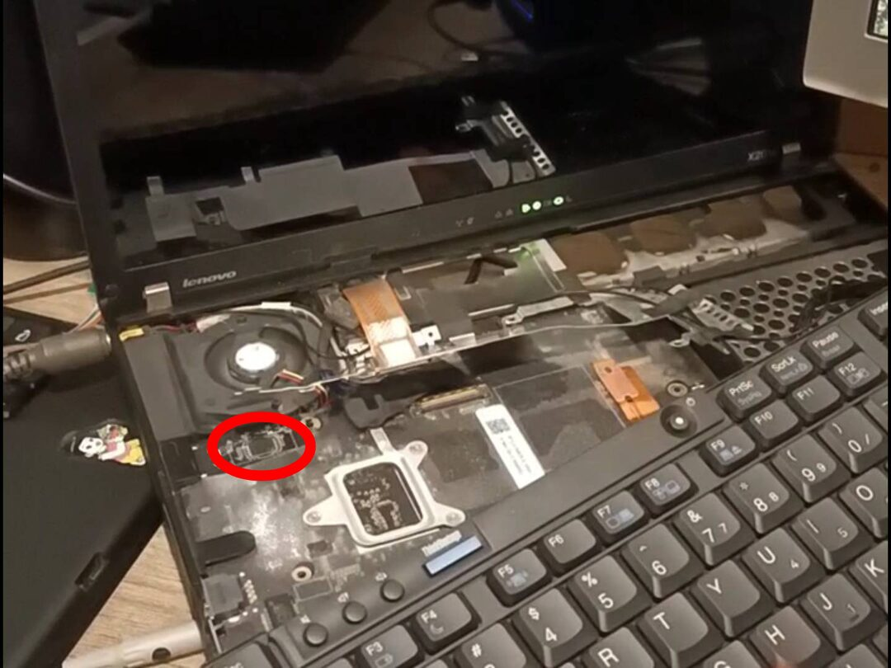

# 51NB X210AI

This page describes how to run coreboot on the 51NB X210AI, a Meteor
Lake-H replacement motherboard for the ThinkPad X200 and X201 (sold with
a Core Ultra 7 165H or Core Ultra 9 185H).

## Disabling Boot Guard

Factory firmware ships with Intel Boot Guard enabled, so check that the
board is still in manufacturing mode before flashing coreboot. Unfused
boards return `90000255` from:

```sh
setpci -s 00:16.0 0x40.l
```

Dump the factory flash and disable Boot Guard on your own image using
Intel MFIT (tested with version 18.0.10.2285). Boards have only been
shown to boot with their own descriptor and ME region, so don't flash a
full SPI dump taken from another board.

```sh
flashrom -p internal -r dump.bin
mfit.exe --decompose dump.bin --saveconfig config.xml
```

Edit `config.xml` and change `BtGuardProfileConfig` from `Debug Profile`
to `Boot Guard Disabled`, then rebuild and write the full image back:

```sh
mfit.exe --loadconfig config.xml --build dump_bgdisabled.bin
flashrom -p internal -w dump_bgdisabled.bin
```

## Flashing coreboot

### Internal programming

Once Boot Guard is disabled, flash only the `bios` region so the existing
descriptor and ME stay untouched:

```sh
flashrom -p internal --ifd -i bios -N -w build/coreboot.rom
```

On the 165H test board, [flashrom 1.8.0] failed to erase over Linux MTD,
and its default PCI ECAM access failed to set BIOS Write Enable even
with `intel-spi` unbound. Building flashrom 1.8.0 with port I/O PCI
access instead of ECAM worked:

```sh
sed -i 's/-DCONFIG_USE_LIBPCI_ECAM=1/-DCONFIG_USE_LIBPCI_ECAM=0/' meson.build
meson setup build -Dprogrammer=internal
ninja -C build
```

Then unbind `intel-spi` and flash the `bios` region:

```sh
echo 0000:00:1f.5 > /sys/bus/pci/drivers/intel-spi/unbind
./build/flashrom -p internal --ifd -i bios -N -w coreboot.rom
```

### External programming

The 32 MiB WSON-8 SPI flash is on the top side of the board under the
keyboard, directly below the fan under a thin metal shield. It is circled
in red here:



## Working

Tested on a Core Ultra 7 165H board with a 3000x2000 eDP panel,
MrChromebox edk2 payload, and Linux:

- Internal eDP display and brightness keys
- HDMI (4K) and USB-C DisplayPort on both ports
- M.2 NVMe (RP10) and 2.5-inch SATA bay
- Realtek RTL8168 GbE, RTL8822BE Wi-Fi and Bluetooth
- Realtek ALC1220 audio output
- All USB 2.0 and USB 3.0 ports
- S3 suspend/resume with lid wake and Intel TME

## Untested

- Second M.2 NVMe slot (RP11)
- Thunderbolt / USB4 tunnelling
- Microphone input
- WWAN slot
- fTPM (Intel PTT is disabled in the factory ME configuration)

[flashrom 1.8.0]: https://download.flashrom.org/releases/flashrom-v1.8.0.tar.xz
